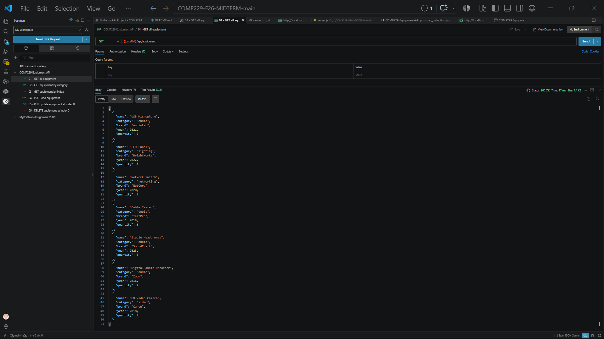
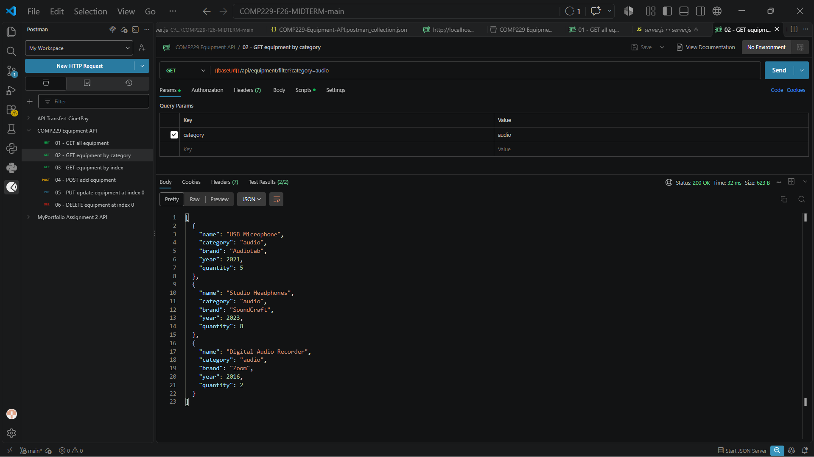
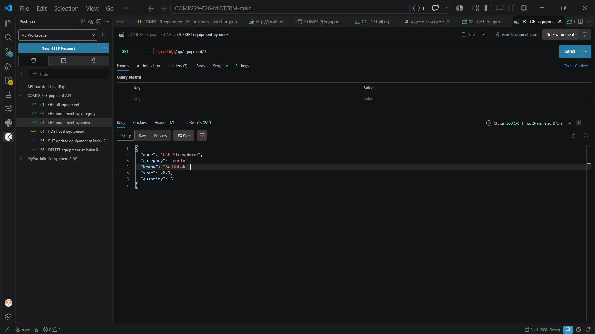
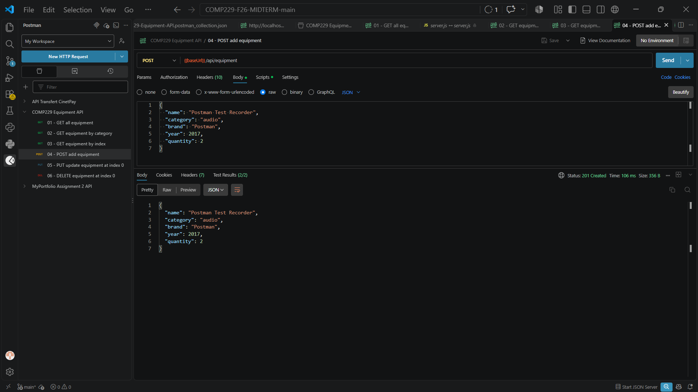
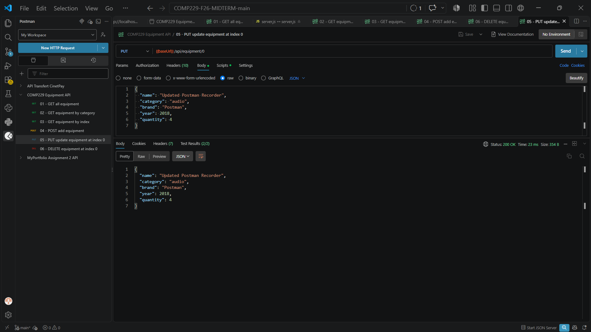
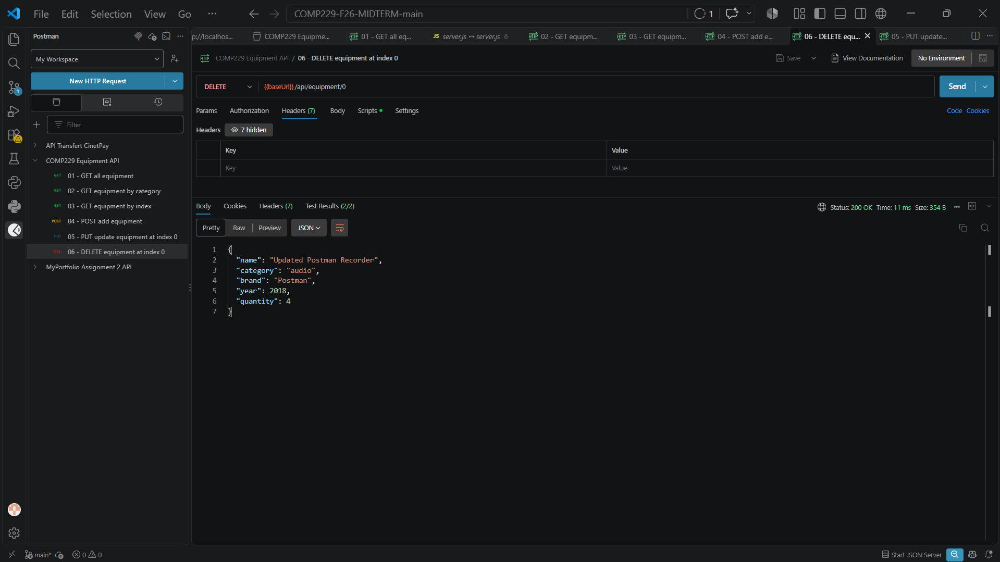

# COMP229 Equipment API Submission

## Validation reflection

I tested the six API endpoints with the Postman collection and ran the automated API checks with `npm test` (8 tests passed). The checks cover the seven-item starting collection, category filtering, array-index lookups, and the POST, PUT, and DELETE operations. I also tested invalid input, including a non-numeric equipment ID, a missing category, and a non-numeric quantity; these requests are rejected with HTTP 400 validation errors.

The personalized equipment items are the Digital Audio Recorder (2016) and HD Video Camera (2018), which meet the 2010–2019 year range for a student ID ending in 4.

## Postman evidence

### 01 — GET all equipment

### 02 — GET equipment by category

### 03 — GET equipment by index

### 04 — POST equipment

### 05 — PUT equipment

### 06 — DELETE equipment

